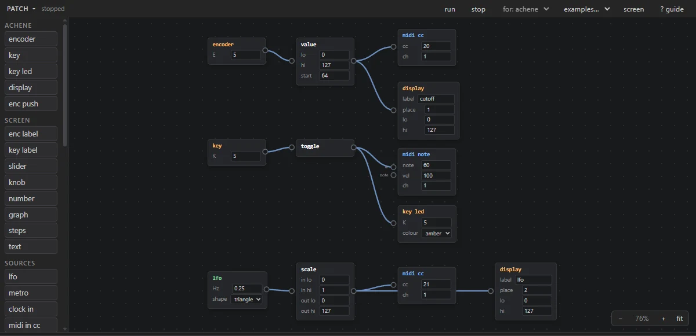

# greenhouse

Where iii devices are tended from the browser: a console that talks to the
device live, the scripts on it and an editor for them, a view of the device
you can play, and graft, a patch editor that wires blocks into a script
without code. Nothing to install: open
[greenhouse.vfmod.com](https://greenhouse.vfmod.com).

<!-- This manual is shared: achene's and parterre's manuals include it (their
PDFs pull it in), leaving out the other device's parts, which sit between
"if: achene" / "if: grid" and "end if" comments. Keep it about greenhouse,
and keep device-only text inside those markers. -->

## What you need

- **Chrome, Edge or Opera** on a computer. greenhouse talks to the device
  over USB with Web Serial, which only these browsers have.
- A USB cable that carries data (many charge-only cables don't).
- An iii device: any of monome's, or one whose firmware adds more to
  greenhouse, such as achene and parterre.

greenhouse installs as an app from the browser's address bar (the install
icon), and then opens with no internet connection. When a newer greenhouse
is published, **update ready ↻** shows in the top right: click it to
reload into it.

## Connecting

Press **connect** (or Ctrl+Shift+C) and pick the device in the list of USB
serial ports. The pill beside the button says whether it's connected, and
the file list on the left fills in. greenhouse reconnects on its own when
the device restarts, until the tab is closed or reloaded.

The welcome page that shows before connecting has the same **connect** and
an **open graft** button: graft works with no device connected.

No device at hand? **device ▾ → virtual grid** (or **or try a virtual grid**
on the welcome page) connects to a 16×8 grid that runs in the page, in any
browser. Everything works as with a grid: the console, files, the grid
drawer, graft and the MIDI monitor (MIDI goes only there). Its files stay in
this browser. To take scripts to a real grid, click **export** in the note at
the top of the file list, then **device ▾ → restore** that zip on the grid;
**import** loads a grid's backup into the virtual one. **disconnect** goes
back to USB devices.

## The console

The middle of the page is the **console**, a REPL: type a line of Lua and
press Enter, and the device runs it and prints the answer. The up and down
arrows bring back earlier lines (kept across sessions), and **Tab**
completes the names of functions and variables (twice: lists the options).

| type        | does                                                                         |
| ----------- | ---------------------------------------------------------------------------- |
| `help()`    | lists every function the device has, its own ones included                   |
| `u`         | opens the file picker to upload a script                                      |
| `r`         | uploads the last script again from your computer and runs it                  |
| `h`         | greenhouse's own commands and shortcuts                                       |
| `hc`        | clears the command history                                                    |
| `^^i`       | restarts Lua and runs the start-up script again                               |
| `^^c`       | restarts Lua without running anything                                         |

The header's **help** button prints the same help as `h` and `help()`.
**reference**, at the top right, opens iii's reference beside the console,
searchable, and works offline too.

## Files

The file list on the left shows the files on the device, with the free
space under it. The arrow beside a file runs it; its **···** menu has the
rest:

| item      | does                                                                                      |
| --------- | ----------------------------------------------------------------------------------------- |
| run       | runs the script                                                                           |
| edit      | opens it in the editor                                                                    |
| rename    | renames it                                                                                |
| download  | saves it to your computer                                                                 |
| first     | makes it the start-up script, the one the device runs at power-up (**not first** undoes it) |
| read      | prints it in the console                                                                  |
| delete    | removes it from the device                                                                |

**upload** in the header, or dropping files anywhere on the page, sends
`.lua` files to the device (several at once). Uploading doesn't run a
script. **+** at the top of the list makes a new, empty one.

### The device menu

**device ▾** in the header:

| item         | does                                                                          |
| ------------ | ----------------------------------------------------------------------------- |
| virtual grid | connects to a grid that runs in the page, instead of a device                 |
| re-init      | restarts Lua and runs the start-up script again, without rebooting            |
| stop script  | stops the running script and clears the LEDs, as after a start with no script |
| reboot       | restarts the device; greenhouse reconnects                                    |
| bootloader   | restarts the device as a USB drive, for a firmware update                     |
| backup       | downloads every file on the device as one zip                                 |
| restore      | uploads the files of a backup zip                                             |
| reformat     | erases every file on the device                                               |
| firmware     | the device's firmware version, and updates where its maker publishes them     |

> **Warning:** **reformat** erases every script on the device. Make a
> **backup** first.

<!-- if: grid -->
On parterre the menu also has **monome mode**: the grid restarts as a monome grid, for norns or
serialosc. Greenhouse can't reach it in that mode, so it disconnects. To come back to iii, hold
the top-left key while plugging the grid in (or hold BOOT for 2 seconds while it runs); once it's
back, greenhouse connects to it again (if it doesn't, press **connect**).
<!-- end if -->

## The editor

**edit** in a file's menu opens the editor beside the console. It knows the
device's functions: it completes them as you type and shows their help
when you hover one. **Ctrl+S** saves to the device, **save as** saves a
copy under another name, and **run** saves and runs. An error the device
reports links to its line. Unsaved work is kept as a draft in the browser,
so a closed tab doesn't lose it.

The editor's bar also moves it below the console or beside it (**⇅**),
wraps long lines, and hides it without closing the file (**–**).

## The MIDI monitor

The **midi** drawer above the console lists the MIDI the device sends and
receives: **in** and **out** pick which, **clock** shows clock messages
too (with the tempo they make), **pause** freezes the list and **clear**
empties it. Its bar counts messages even while it's closed.

<!-- if: achene -->

## The achene drawer

With achene connected, the **achene** drawer shows its panel, drawn to
scale: the keys light as they do on the device, and its screen shows what
achene's shows. Everything on it plays achene:

| on the panel      | how                                                                                       |
| ----------------- | ----------------------------------------------------------------------------------------- |
| turn an encoder   | drag it up or down (or right and left), scroll over it, or the arrow keys when it's selected |
| push an encoder   | click it without moving; hold still a moment and it stays pushed, so dragging then turns it pushed |
| press a key       | click and hold it; with touch, several at once                                             |
| hold one down     | shift-click or right-click: it stays down until clicked again, or **release** lets go of all |

With the panel selected, the computer's keyboard plays the keys, laid out
as on the panel:

| computer keys         | achene keys                                 |
| --------------------- | ------------------------------------------- |
| Z X C V               | K1–K4, under the screen                     |
| Y U I O P             | K5–K8, then K13 (tap)                       |
| H J K L ;             | K9–K12, then K14 (play)                     |
| \[ and '              | K15 and K16, beside the encoders            |

**? controls** shows this on the panel. The colour menu matches the screen
to your OLED module (white, blue, yellow or green), and **full screen**
shows the panel alone, for playing (Esc to leave).

### trellis presets

trellis's presets can be edited here too, with the whole preset in front of
you instead of four settings at a time. It's the quickest way to set up a
new preset's slots, name everything, or tidy a song.

trellis saves its presets as `pset_trellis_1.lua` to `pset_trellis_16.lua`.
The file list hides them with the other data files: press **data files
hidden: show** at the bottom of the list. Then open a preset's **···** menu
and pick **edit preset**.

- **The banks** are down the left, A to H in their colours. A slots bank
  shows its eight slots, each with its encoder, its key and, when it has
  one, its LFO or motion. Only the settings that apply show: pick a key
  type and its own settings appear. A track shows its settings, its eight
  patterns and its steps, a page of 16 at a time; a drums track also shows
  its kit.
- **Patterns:** P1 to P8 pick the one you see; ▶ marks the one playing.
  **make it the one playing** makes trellis load the preset on it.
- **Steps:** click a step to turn it on or off. A melodic step's note,
  velocity, gate and chance are under it; on a drums track, click a lane's
  name to set its hits' velocities and chances.
- **scenes, song** at the bottom of the list has the scenes (each track's
  pattern and mute: S1 to S8, and S9 to S16 with **show S9–S16** or once
  one of them is stored), the song as a table (each entry's scene and
  bars, the length in all, ↑ ↓ to move one) and the performance page's
  assign.
- **Copy and paste:** each slot has **copy** and **paste**, and so does each
  bank (its name, slots and track): copy one, go to another, paste. On a
  track, **copy P1** then pick P2 and **paste into P2** to start a pattern
  from one you have and change a few steps. The top of the editor says
  what's copied; a drums pattern only pastes into a drums track, and a
  melodic one into a melodic track.
- **Dragging numbers:** drag a step's note up or down to change it, and
  its name follows as you go (shift: by octaves); the mouse wheel does
  the same. Velocity, gate, chance and the kit's notes drag too. A click
  without dragging lets you type the number.
- A chance can also be a **trig condition**, as on achene past 100%: type
  `1:2` (the first pass of every two) up to `8:8`, `1st` (the first pass
  only) or `!1st` (all but it), or drag past 100%.
- Names follow the device's rules: lowercase, and up to 8 characters for a
  slot, 10 for a bank.

**save** writes the preset back, as the number picked beside it: keep it,
or pick another number to save a copy. If it's the preset trellis has
loaded, achene plays it at once, in time; changes made on achene and not
saved give way to it (the console says so). Another number joins
trellis's presets: load it on achene as usual (K15, choose it with E1,
K2).

The clock, the sync jacks, MIDI thru and the arpeggiator aren't in a
preset (trellis keeps them in `trellis.cfg`), so they aren't here.

<!-- end if -->

<!-- if: grid -->

## The grid drawer

With parterre connected, the **grid** drawer shows the grid's LEDs live,
and clicking a key presses it. Shift-click or right-click holds a key down
until it's clicked again; **release** lets go of all of them.

<!-- end if -->

## graft, the patch editor

**graft** in the header opens the patch editor, with or without a device
connected. A patch is **blocks** joined by **wires**. Each block does one
small thing; when something happens (an encoder turns, a beat ticks, a
note comes in) a number travels along its wires to the next blocks. The
patch runs on the device itself, and keeps running once it's saved,
without greenhouse.

### Blocks and wires

The palette on the left lists the blocks by group: the connected device's
own (achene's panel and screen, or the grid), then **sources** that start
messages (LFO, metro, clock and MIDI in), **process**, **math** and
**memory** to shape them, **output** to send them out (MIDI, print), and
**custom**, a block of your own Lua. With no device connected, **for:** in
the bar picks which device's blocks to show.

- **Add a block**: click it in the palette, or drag it onto the canvas.
  Hover a block's title, a field or a port to see what it does.
- **Wire**: drag from an output (a block's right side) to an input (its
  left side), or back. One output can feed many inputs. Named ports show
  their name, such as a math block's *a* and *b*.
- **Remove**: click a wire and press Delete (or right-click it and click
  ×); select blocks and press Delete.
- **Settings by wire**: most number fields (a MIDI channel, a CC number, lo
  and hi, an LFO's rate, a slew's time) also have an input of their own,
  and so do a few lists (an LFO's shape, a quantize's scale: a number picks
  from the list, 1 for the first). These inputs are square and named
  after their field; they show while you draw a wire and stay while one is
  plugged in, and the field then only says where it starts. Wire an encoder through a value block (1 to 16) into a midi cc's
  *ch* to turn its channel. The block reference marks these settings •.

### Moving around

| do                          | to                                                                     |
| --------------------------- | ---------------------------------------------------------------------- |
| mouse wheel                 | zoom around the pointer (or − 100% + and **fit**, bottom right)        |
| drag on empty space         | select the blocks in a box (shift adds)                                |
| click a block               | select it; shift- or ctrl-click adds or removes one                    |
| drag a block's title        | move it, with the rest of the selection                                |
| space + drag, middle button | pan                                                                    |
| ctrl+C, X, V                | copy, cut, paste, with the wires between the blocks; a paste lands under the mouse, in this tab or another |
| ctrl+D, ctrl+A              | duplicate the selection; select every block                            |
| right-click                 | a block's or a selection's menu; on empty canvas, paste or select all  |
| Delete, Esc                 | remove the selection; let go of it                                     |

### Running it

- **run** starts the patch on the device, from scratch; **stop** stops it.
- With **live** on, every edit reaches the running patch at once. With it
  off, edits wait, and **apply** sends them together without restarting.
- **examples…** loads a whole patch to start from (it replaces the
  canvas); **clear** removes every block. **? guide** has these notes and
  small **recipes**, wirings that **add** puts beside what's there.

### Saving and sharing

- **save…** writes the patch to the device as a script that runs on its
  own, marked *patch* in the file list; **open…** brings one back to the
  canvas.
- **export…** and **import…** do the same with a file on your computer, so
  a patch can be made, kept and shared with no device connected.
- Blocks that remember things (a sequence and its notes, a value, a toggle,
  a counter, a memory) keep them: **stop**, **save…** and **export…** ask
  the device for them, so the patch starts again where you left off.
- On the device, without greenhouse, a **set var** with **keep** ticked
  keeps its value: the value is written to the device when it changed, at
  most once a minute so the flash doesn't wear, and comes back when the
  patch starts, even after a power cut. Its **get var** sends it at the
  start; wire that to a value block's *set* input too, so turning goes on
  from the kept value (the recipe *a channel you turn* does this). Kept
  values go by name and are shared by every patch on the device. Turns
  made in the last minute before a power cut can be lost; **stop** writes
  them at once.
- A saved patch carries the part of graft's runtime it uses, so it runs on
  its own, and the device holds only the blocks it needs. greenhouse tells
  you about blocks it doesn't know when you open or import a patch.

<!-- if: achene -->

### achene's screen

The screen blocks share a grid that matches the panel: four columns, under
the encoders E1–E4 and over the keys K1–K4, and rows for each job (top,
middle, bottom). Each block takes a **row**, a **column** and a **width**
in columns, so a label sits right over the encoder it names. **screen** in
graft's bar shows the layout: drag a box to move its block, drag its right
edge to widen it.

**Pages** give the panel a shift. Encoders, pushes, keys, key LEDs and
screen blocks have a **page** setting: *always* (every page, as before) or
a page from 1 to 4, where the block acts and shows only while its page is
shown. A **page** block picks the page: *hold* shows its page while a key
is held (hold K4 to see and turn settings over E1–E4), *step* moves through
the pages from an encoder or a key, *number* takes the page from a counter
or a value. Give an encoder one encoder block per page, each with its own
value, so nothing jumps when you come back. The screen layout shows one
page at a time.

More screen blocks: **bars** fits four thin bars in one column, so two of
them show E5–E12 on half the screen; **shows as** on enc label, slider,
knob, number and bars turns the number into names (`off,on`), a format
(`ch #`), a note name (`note`) or a number with a unit (`ms`); **draw** is a
screen block of your own Lua, drawing its place with text, line, rect and
pixel from its inputs.

The examples put it together: **sequencer**, 16 steps drawn across the
middle and played from the keys under E5–E12 (press a step, then turn E1
for its note), and **controller**, four CCs on E1–E4, named over their
encoders.

<!-- end if -->

<!-- if: grid -->

### The grid

Grid widgets take a rectangle of keys: **x** and **y** for the top left key
(1, 1 is the grid's top left), **width** and **height** in keys. A press
goes to the widget under it, and the grid's picture is redrawn at most 50
times a second. The grid layout places and sizes them by dragging.

<!-- end if -->

<!-- include: Blocks.md -->

Every block, recipe and example is described in the
[block reference](Blocks.md).
