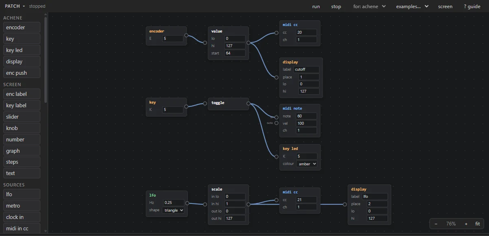

# greenhouse

Where iii devices are tended from the browser: a console that talks to the
device live, the scripts on it and an editor for them, a view of the device
you can play, and graft, a patch editor that wires blocks into a script
without code. Nothing to install: open
[greenhouse.vfmod.com](https://greenhouse.vfmod.com).

<!-- This manual is shared: achene's and parterre's manuals include it (their
PDFs pull it in), leaving out the other device's parts, which sit between
"if: achene" / "if: grid" and "end if" comments. Keep it about greenhouse,
and keep device-only text inside those markers. -->

## What you need

- **Chrome, Edge or Opera** on a computer. greenhouse talks to the device
  over USB with Web Serial, which only these browsers have.
- A USB cable that carries data (many charge-only cables don't).
- An iii device: any of monome's, or one whose firmware adds more to
  greenhouse, such as achene and parterre.

greenhouse installs as an app from the browser's address bar (the install
icon), and then opens with no internet connection. When a newer greenhouse
is published, **update ready ↻** shows in the top right: click it to
reload into it.

## Connecting

Press **connect** (or Ctrl+Shift+C) and pick the device in the list of USB
serial ports. The pill beside the button says whether it's connected, and
the file list on the left fills in. greenhouse reconnects on its own when
the device restarts, until the tab is closed or reloaded.

The welcome page that shows before connecting has the same **connect** and
an **open graft** button: graft works with no device connected.

## The console

The middle of the page is the **console**, a REPL: type a line of Lua and
press Enter, and the device runs it and prints the answer. The up and down
arrows bring back earlier lines (kept across sessions), and **Tab**
completes the names of functions and variables (twice: lists the options).

| type        | does                                                                         |
| ----------- | ---------------------------------------------------------------------------- |
| `help()`    | lists every function the device has, its own ones included                   |
| `u`         | opens the file picker to upload a script                                      |
| `r`         | uploads the last script again from your computer and runs it                  |
| `h`         | greenhouse's own commands and shortcuts                                       |
| `hc`        | clears the command history                                                    |
| `^^i`       | restarts Lua and runs the start-up script again                               |
| `^^c`       | restarts Lua without running anything                                         |

The header's **help** button prints the same help as `h` and `help()`.
**reference**, at the top right, opens iii's reference beside the console,
searchable, and works offline too.

## Files

The file list on the left shows the files on the device, with the free
space under it. The arrow beside a file runs it; its **···** menu has the
rest:

| item      | does                                                                                      |
| --------- | ----------------------------------------------------------------------------------------- |
| run       | runs the script                                                                           |
| edit      | opens it in the editor                                                                    |
| rename    | renames it                                                                                |
| download  | saves it to your computer                                                                 |
| first     | makes it the start-up script, the one the device runs at power-up (**not first** undoes it) |
| read      | prints it in the console                                                                  |
| delete    | removes it from the device                                                                |

**upload** in the header, or dropping files anywhere on the page, sends
`.lua` files to the device (several at once). Uploading doesn't run a
script. **+** at the top of the list makes a new, empty one.

### The device menu

**device ▾** in the header:

| item        | does                                                                          |
| ----------- | ----------------------------------------------------------------------------- |
| re-init     | restarts Lua and runs the start-up script again, without rebooting            |
| stop script | stops the running script and clears the LEDs, as after a start with no script |
| reboot      | restarts the device; greenhouse reconnects                                    |
| bootloader  | restarts the device as a USB drive, for a firmware update                     |
| backup      | downloads every file on the device as one zip                                 |
| restore     | uploads the files of a backup zip                                             |
| reformat    | erases every file on the device                                               |
| firmware    | the device's firmware version, and updates where its maker publishes them     |

> **Warning:** **reformat** erases every script on the device. Make a
> **backup** first.

<!-- if: grid -->
On parterre the menu also has **monome mode**: the grid restarts as a monome grid, for norns or
serialosc. Greenhouse can't reach it in that mode, so it disconnects. To come back to iii, hold
the top-left key while plugging the grid in (or hold BOOT for 2 seconds while it runs); once it's
back, greenhouse connects to it again (if it doesn't, press **connect**).
<!-- end if -->

## The editor

**edit** in a file's menu opens the editor beside the console. It knows the
device's functions: it completes them as you type and shows their help
when you hover one. **Ctrl+S** saves to the device, **save as** saves a
copy under another name, and **run** saves and runs. An error the device
reports links to its line. Unsaved work is kept as a draft in the browser,
so a closed tab doesn't lose it.

The editor's bar also moves it below the console or beside it (**⇅**),
wraps long lines, and hides it without closing the file (**–**).

## The MIDI monitor

The **midi** drawer above the console lists the MIDI the device sends and
receives: **in** and **out** pick which, **clock** shows clock messages
too (with the tempo they make), **pause** freezes the list and **clear**
empties it. Its bar counts messages even while it's closed.

<!-- if: achene -->

## The achene drawer

With achene connected, the **achene** drawer shows its panel, drawn to
scale: the keys light as they do on the device, and its screen shows what
achene's shows. Everything on it plays achene:

| on the panel      | how                                                                                       |
| ----------------- | ----------------------------------------------------------------------------------------- |
| turn an encoder   | drag it up or down (or right and left), scroll over it, or the arrow keys when it's selected |
| push an encoder   | click it without moving; hold still a moment and it stays pushed, so dragging then turns it pushed |
| press a key       | click and hold it; with touch, several at once                                             |
| hold one down     | shift-click or right-click: it stays down until clicked again, or **release** lets go of all |

With the panel selected, the computer's keyboard plays the keys, laid out
as on the panel:

| computer keys         | achene keys                                 |
| --------------------- | ------------------------------------------- |
| Z X C V               | K1–K4, under the screen                     |
| Y U I O P             | K5–K9                                       |
| H J K L ;             | K10–K14                                     |
| \[ and '              | K15 and K16, beside the encoders            |

**? controls** shows this on the panel. The colour menu matches the screen
to your OLED module (white, blue, yellow or green), and **full screen**
shows the panel alone, for playing (Esc to leave).

<!-- end if -->

<!-- if: grid -->

## The grid drawer

With parterre connected, the **grid** drawer shows the grid's LEDs live,
and clicking a key presses it. Shift-click or right-click holds a key down
until it's clicked again; **release** lets go of all of them.

<!-- end if -->

## graft, the patch editor

**graft** in the header opens the patch editor, with or without a device
connected. A patch is **blocks** joined by **wires**. Each block does one
small thing; when something happens (an encoder turns, a beat ticks, a
note comes in) a number travels along its wires to the next blocks. The
patch runs on the device itself, and keeps running once it's saved,
without greenhouse.

### Blocks and wires

The palette on the left lists the blocks by group: the connected device's
own (achene's panel and screen, or the grid), then **sources** that start
messages (LFO, metro, clock and MIDI in), **process**, **math** and
**memory** to shape them, **output** to send them out (MIDI, print), and
**custom**, a block of your own Lua. With no device connected, **for:** in
the bar picks which device's blocks to show.

- **Add a block**: click it in the palette, or drag it onto the canvas.
  Hover a block's title, a field or a port to see what it does.
- **Wire**: drag from an output (a block's right side) to an input (its
  left side), or back. One output can feed many inputs. Named ports show
  their name, such as a math block's *a* and *b*.
- **Remove**: click a wire and press Delete (or right-click it and click
  ×); select blocks and press Delete.

### Moving around

| do                          | to                                                                     |
| --------------------------- | ---------------------------------------------------------------------- |
| mouse wheel                 | zoom around the pointer (or − 100% + and **fit**, bottom right)        |
| drag on empty space         | select the blocks in a box (shift adds)                                |
| click a block               | select it; shift- or ctrl-click adds or removes one                    |
| drag a block's title        | move it, with the rest of the selection                                |
| space + drag, middle button | pan                                                                    |
| ctrl+C, X, V                | copy, cut, paste, with the wires between the blocks; a paste lands under the mouse, in this tab or another |
| ctrl+D, ctrl+A              | duplicate the selection; select every block                            |
| right-click                 | a block's or a selection's menu; on empty canvas, paste or select all  |
| Delete, Esc                 | remove the selection; let go of it                                     |

### Running it

- **run** starts the patch on the device, from scratch; **stop** stops it.
- With **live** on, every edit reaches the running patch at once. With it
  off, edits wait, and **apply** sends them together without restarting.
- **examples…** loads a whole patch to start from (it replaces the
  canvas); **clear** removes every block. **? guide** has these notes and
  small **recipes**, wirings that **add** puts beside what's there.

### Saving and sharing

- **save…** writes the patch to the device as a script that runs on its
  own, marked *patch* in the file list; **open…** brings one back to the
  canvas.
- **export…** and **import…** do the same with a file on your computer, so
  a patch can be made, kept and shared with no device connected.
- Blocks that remember things (a sequence and its notes, a value, a toggle,
  a counter, a memory) keep them: **stop**, **save…** and **export…** ask
  the device for them, so the patch starts again where you left off.
- A saved patch carries the part of graft's runtime it uses, so it runs on
  its own, and the device holds only the blocks it needs. greenhouse tells
  you about blocks it doesn't know when you open or import a patch.

<!-- if: achene -->

### achene's screen

The screen blocks share a grid that matches the panel: four columns, under
the encoders E1–E4 and over the keys K1–K4, and rows for each job (top,
middle, bottom). Each block takes a **row**, a **column** and a **width**
in columns, so a label sits right over the encoder it names. **screen** in
graft's bar shows the layout: drag a box to move its block, drag its right
edge to widen it.

The examples put it together: **sequencer**, 16 steps drawn across the
middle and played from the keys under E5–E12 (press a step, then turn E1
for its note), and **controller**, four CCs on E1–E4, named over their
encoders.

<!-- end if -->

<!-- if: grid -->

### The grid

Grid widgets take a rectangle of keys: **x** and **y** for the top left key
(1, 1 is the grid's top left), **width** and **height** in keys. A press
goes to the widget under it, and the grid's picture is redrawn at most 50
times a second. The grid layout places and sizes them by dragging.

<!-- end if -->

<!-- include: Blocks.md -->

Every block, recipe and example is described in the
[block reference](Blocks.md).
